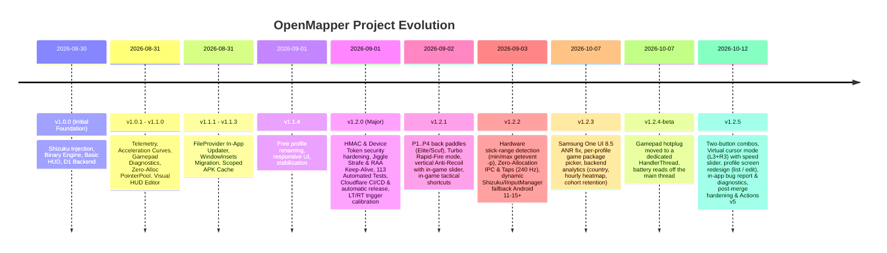

# 🤖 OpenMapper — Technical Guide, Architecture & Engineering Decisions (`agent.md`)

> **Reference document for any AI agent, developer or contributor working on the OpenMapper project (`kinou-p/android-open-mapper`).**

---

## 📑 Table of Contents
1. [Overview & Project Vision](#1-overview--project-vision)
2. [History & Commit Evolution Analysis](#2-history--commit-evolution-analysis)
3. [Global Architecture & Multi-Thread Concurrency Model](#3-global-architecture--multi-thread-concurrency-model)
   - [3.1 End-to-End Functional Diagram](#31-end-to-end-functional-diagram)
   - [3.2 Concurrency Model & Multi-Thread Flows](#32-concurrency-model--multi-thread-flows)
4. [Detailed Architecture — Android Client](#4-detailed-architecture--android-client)
   - [4.1 Real-Time Engine & Low-Level Input (`engine`)](#41-real-time-engine--low-level-input-engine)
   - [4.2 Touch Injection Layer (`injector`)](#42-touch-injection-layer-injector)
   - [4.3 Services & Overlay HUD Editor (`service` & `ui/overlay`)](#43-services--overlay-hud-editor-service--uioverlay)
   - [4.4 Data Management, Local Security & Updates (`data`)](#44-data-management-local-security--updates-data)
   - [4.5 Jetpack Compose UI (`ui/screens`)](#45-jetpack-compose-ui-uiscreens)
5. [Detailed Architecture — Cloudflare Workers & D1 Backend](#5-detailed-architecture--cloudflare-workers--d1-backend)
6. [Hardware Compatibility Matrix, Linux Input & Kernel Events](#6-hardware-compatibility-matrix-linux-input--kernel-events)
7. [Why These Choices? Rationale, Threat Model & Trade-offs](#7-why-these-choices-rationale-threat-model--trade-offs)
   - [7.1 Key Engineering Decisions Table](#71-key-engineering-decisions-table)
   - [7.2 Threat Model & Security Philosophy (Threat Model)](#72-threat-model--security-philosophy-threat-model)
8. [Contribution Guide & Imperative Rules for Agents](#8-contribution-guide--imperative-rules-for-agents)
9. [Diagnostic Playbook & Troubleshooting for Agents](#9-diagnostic-playbook--troubleshooting-for-agents)
10. [Gotchas & Common Pitfalls](#10-gotchas--common-pitfalls)
11. [Technical Roadmap & Next Work Items (`TODO.md`)](#11-technical-roadmap--next-work-items-todomd)

---

## 1. Overview & Project Vision

**OpenMapper** (package name `com.kinou.gameassist`) is a standalone, ultra-high-performance native Android application written in **Kotlin** and **Jetpack Compose** (Android 8.0 / API 26 through Android 15 / API 35+), backed by a serverless **Cloudflare Workers** infrastructure (Hono + distributed Edge SQL database D1).

### 🎯 The Problem It Solves
On Android, most competitive action games (*Call of Duty: Mobile*, *Warzone Mobile*, *PUBG Mobile*, *Genshin Impact*, *Brawl Stars*, etc.) do not natively support every physical controller, or they impose matchmaking restrictions by splitting lobbies. Proprietary market solutions (*Mantis Gamepad Pro*, *Panda Gamepad*, *Octopus*) suffer from major drawbacks:
- **Aggressive business model**: paid subscriptions, intrusive ads, locked pro features.
- **Noticeable injection latency** (> 15 to 30 ms).
- **Anti-cheat ban risk**: injection of closed-source, unaudited third-party binaries into `/data/local/tmp`.
- **Compatibility instability**: regressions on modern Android versions (Android 12 to 15).

### 🚀 The OpenMapper Answer
- **100% Free, Open-Source & Ad-Free** (*PolyForm Noncommercial 1.0.0* license).
- **No Root & 100% Standalone on the Phone**: uses **Shizuku** (`shell` UID 2000 privileges through local Wireless Debugging ADB, with no permanent PC).
- **Sub-Millisecond Latency (< 0.5 ms)**: direct binary decoding and streaming from `/dev/input/event*`, coupled with non-blocking asynchronous injection into `IInputManager` through Binder (`mode = 0`).
- **High 120-240 Hz Rate & Zero Garbage Collection (0 GC)**: active loop on a dedicated thread with pre-allocated bit-shift binary decoders, eliminating all GC churn.
- **Advanced e-Sport Features**:
  - Smooth infinite 360° camera rotation (*Dual-Pointer Interlaced Handoff*).
  - Ultra-fast 180° flick with automatic attenuation under scope aim (*ADS Safety*).
  - Aim-assist keep-alive (*Rotational Aim Assist / RAA Keep-Alive*).
  - Biometric human-like strafe (*Organic Jiggle Strafe*, cosine-interpolated).
  - Active vertical recoil compensation (*Active Anti-Recoil*) with an in-game overlay slider.
  - Configurable Turbo Rapid-Fire mode (4 to 30 Hz) and asynchronous haptic feedback.
  - Full in-game HUD editor with game screenshot, magnetic alignment and tactical shortcuts.

---

## 2. History & Commit Evolution Analysis

The complete chronological analysis of the Git history shows a clear trajectory: from a working proof of concept to a hardened, industrial-grade architecture.



### Development Phases in Detail:

1. **Initial Release v1.0.0 (`ea145dc` ➔ `aa7b2a5`)**:
   - Creation of the Android Kotlin/Compose module and the Cloudflare Workers Hono/D1 backend.
   - Implementation of the Shizuku bridge to the `android.hardware.input.IInputManager` system IPC interface.
   - Automated build and release pipeline with GitHub Actions.

2. **Optimization & Diagnostics Phase v1.0.1 to v1.1.0 (`51ba056` ➔ `1112d5f`)**:
   - **Anonymous telemetry** and privacy-respecting global statistics.
   - **Separate sensitivities**: general sensitivity split from scope (ADS) sensitivity, axis inversion, response curves (Linear, Standard, Dynamic, Dynamic Boost).
   - **Real-time visualizer and gamepad test bench** (`GamepadTestScreen`) with effective refresh-rate (Hz), latency, jitter and a 3-second automatic stick drift test.
   - **Zero-Allocation optimization (`f04a7af`)**: introduction of `PointerPool` with pre-allocated static buffers and parsing without object instantiation.

3. **HUD & Update System Phase v1.1.1 to v1.1.3 (`f894d0d` ➔ `075e88b`)**:
   - **In-App Auto-Updater**: automatic detection of GitHub releases and direct in-app download/installation through `FileProvider`.
   - **Overlay modernization**: migration to the modern `WindowInsetsController` API (Android 11+ / API 30+) and removal of deprecated `FLAG_FULLSCREEN` flags.
   - **Unified app signing** and strict APK cache isolation to avoid installation conflicts.

4. **Ergonomics Phase v1.1.4 (`5cdd682` ➔ `acdf0bf`)**:
   - UX improvements in `ProfileEditorScreen`: direct profile renaming, responsive action-button fix and cleanup of redundant tabs.

5. **Secrets & Security Remediation Phase (`c3654dc` / `616d404`)**:
   - Removal of the keystore file from Git tracking, key management through environment variables and `local.properties`.
   - Secure injection of build secrets through GitHub Actions Secrets (`KEYSTORE_BASE64`, `APP_SECRET`).

6. **Device Identity Redesign (`645c891` ➔ `aa06350`)**:
   - *Identified problem*: the old system computed `deviceHash = SHA256(ANDROID_ID + salt)` client-side. Since `APP_SECRET` can be extracted by decompiling the APK, an attacker could forge arbitrary `deviceHash` values to spam profiles or rig votes.
   - *Adopted solution*: creation of the `POST /api/device/register` route, which issues a high-entropy opaque token (256 bits). The server only stores `SHA256(deviceToken)`. On Android, the token is stored in `EncryptedSharedPreferences` through the `DeviceTokenStore` component.

7. **Major Real-Time Engine Redesign & Global Hardening v1.2.0 (`2018889` ➔ `a53ff40`)**:
   - **GamepadEngine**: replaced the coroutine with a dedicated high-priority native `Thread` (`THREAD_PRIORITY_URGENT_DISPLAY`) using a two-phase sub-microsecond hybrid sleep algorithm (`LockSupport.parkNanos` + `Thread.onSpinWait`).
   - **Synchronization & Concurrency**: use of `AtomicBoolean` and `AtomicInteger` in `LinuxInputReader` and `ButtonProcessor` (lock-free fire/aim counters).
   - **ProfileRepository**: migration to a reactive `StateFlow<List<GameProfile>>` shared between `MainActivity`, `OverlayService` and `CommunityScreen`.
   - **Storage Security**: absolute anti-Path-Traversal protection in `ProfileRepository` and `ScreenshotManager` (regex validation and strict canonical path checks with `File.getCanonicalPath()`).
   - **Backend**: atomic SQLite triggers in Cloudflare D1 (`trg_votes_insert`, `trg_votes_update`, `trg_votes_delete` with `MAX(0, count - 1)`), two-level HMAC anti-replay cache (memory + D1), IPv6 `/64` subnet normalization.
   - **APK updates**: cryptographic verification of the SHA-256 fingerprint of the downloaded APK signing certificates against the installed application before any package-installer execution.
   - **Test Suites & CI**: expanded unit tests (full engine and backend coverage), Gradle wrapper validation and conditional release publishing.

8. **Advanced Competitive Features v1.2.1 (`5dce711` ➔ `3d29c83`)**:
   - **Back Paddle support (`BUTTON_PADDLE1` to `BUTTON_PADDLE4`)** for competitive controllers (Xbox Elite, Scuf, Razer, third-party controllers mapping M1..M4).
   - **Turbo Rapid-Fire mode**: paced automatic fire (4 to 30 Hz) with tiny human-like drift (+/- 2.5 px) and per-shot synchronized haptics.
   - **Active Vertical Anti-Recoil**: continuous compensating pull-down while firing, with in-game adjustable speed through an interactive slider in the side overlay panel (`EdgeHandleOverlayView`).
   - **In-Game Tactical Shortcuts**: direct physical-button roles (`TOGGLE_RECOIL`, `TOGGLE_STRAFE`, `SWITCH_PROFILE`) with toast alerts in the overlay.

9. **Post-Audit Stabilization, Zero-Allocation & Global Resilience v1.2.2 (`d02629e` ➔ `82f3904`)**:
   - **Backend IP anonymization**: use of the server-side `IP_SALT`, decoupled from `APP_SECRET`, for GDPR-compliant hashing of IP addresses.
   - **`LinuxInputReader` coroutine lifecycle**: the `readerJob` is kept alive through `jobsToWait.joinAll()`, preventing premature termination of gamepad capture in the background.
   - **getevent -p hardware inspection & stick detection**: direct analysis of the `min`/`max` limits declared by the kernel driver for each axis, eliminating at-rest lockups on wired or Bluetooth sticks (transparent support for 0..65535, -32768..32767 and 0..255). Dynamic self-learning as a fallback when metadata is missing.
   - **Zero-Allocation IPC & Taps (240 Hz)**: pre-allocation of reflection arguments in `IInputManagerHelper` (`cachedArgs2`, `cachedArgs3` with `ZERO_INTEGER`) and a fixed `PendingTapSlot[16]` pool in `ButtonProcessor`, removing all GC churn.
   - **Resilient double fallback in `IInputManagerHelper`**: dynamic AIDL / 2- and 3-parameter reflection detection, guaranteeing transparent compatibility from Android 11 to Android 15+. Isolation of preventive startup cancellations so the helper is never killed at launch.
   - **Hardware filtering & generic Bluetooth**: exclusion of the phone's physical keys (`keypad`/`kpd`), precise routing for third-party Bluetooth controllers (`GENERIC_BLUETOOTH`) and recalibrated 0..255 trigger thresholds.

10. **Combos, Virtual Cursor & Post-Merge Hardening v1.2.3 ➔ v1.2.5**:
    - **Samsung One UI 8.5 ANR fix (v1.2.3)**: see commit `59d38d0`.
    - **Per-profile game package picker (v1.2.3)**: app selection dialog (icon + label) stored in `profile.packageName` and shown in the editor.
    - **Backend analytics**: country geolocation, hourly activity heatmap and cohort retention exposed by `/api/stats`.
    - **Hotplug off the main thread (v1.2.4-beta)**: `InputDeviceListener` callbacks moved to `InputDeviceCallbacks.handler` (gotcha #13), then battery reads moved off the main thread (`BatteryState` cache fed by a dedicated executor).
    - **Two-button combos**: a HUD button can be assigned to `R1+X` from the editor (held modifier + trigger). Precomputed `combosByTrigger` index, allocation-free `findCombo()`, normalized/validated keys and a `ComboRouter` cleared on every state reset.
    - **Virtual cursor mode (L3+R3)**: non-touchable `CursorOverlayView`, stick-driven movement (quadratic curve), `A` taps/drags, `B` exits, D-pad speed control (0.25x–5x) persisted in `cursor_speed`; the click is deferred until the joystick pointer is released.
    - **Engine & data hardening**: stale-combo ghost keys, lost cursor click, battery request queue (`BatteryRefreshQueue`) and profile writes deferred to an immutable copy.
    - **CI**: `actions/checkout` and `actions/setup-node` at `@v5` (Node 24 runners).
    - **Profile screen redesign**: `ProfileEditorScreen` becomes the list (create, duplicate, rename, import/export, activate) and `ProfileEditScreen` the single-profile editor; `LiveProfileSync` prevents a non-active profile from switching the live engine.
    - **In-app bug report & diagnostics**: `OpenMapperApp` installs a crash handler and a bounded log very early (`util/AppLog.kt`, never called from the input loop); `data/diagnostics/` builds a whitelist-based report (version, device, ROM, Shizuku, controllers, active profile, log), displayed by `BugReportScreen` and ready to copy.
    - **Asynchronous vibrations & overlay concurrency**: `playFireHaptic` moved to non-blocking `hapticScope.launch` and `liveProfileUpdateFlow` converted to `MutableSharedFlow(replay = 0, extraBufferCapacity = 1)`.

---

## 3. Global Architecture & Multi-Thread Concurrency Model

### 3.1 End-to-End Functional Diagram

```mermaid
flowchart TB
    subgraph HARDWARE ["Devices & Hardware"]
        PAD["Gamepad (Bluetooth / USB-C OTG)"]
        SCREEN["Touchscreen / Digitizer"]
    end

    subgraph KERNEL ["Linux Kernel & Drivers"]
        DEV["/dev/input/event* (Gamepad Event Nodes)"]
        TOUCH_DEV["/dev/input/event* (Touchscreen Driver)"]
    end

    subgraph SHIZUKU_PRIV ["Privileged Shizuku Process (UID 2000 / Shell)"]
        SH_CAT["Elevated 'cat /dev/input/event*' Process"]
        SH_BINDER["IInputManager System Service (Binder IPC)"]
    end

    subgraph ENGINE ["OpenMapper Core Engine (Android Native)"]
        LIR["LinuxInputReader (Multi-Threaded IO)"]
        BIP["BinaryInputParser (Zero-Alloc 24B/16B)"]
        GE["GamepadEngine (120-240Hz Loop / High-Priority Thread)"]
        
        MP["MovementProcessor (RAA & Jiggle Strafe)"]
        CP["CameraProcessor (Dual-Pointer Handoff)"]
        BP["ButtonProcessor (Hold / Tap / Atomic Counters)"]
        HAPTIC["HapticManager (Fire / Reload Vibrations)"]
    end

    subgraph INJECTOR ["Touch Injection Layer"]
        STI["ShizukuTouchInjector (ReentrantLock)"]
        PP["PointerPool (Static Buffers, 10 Fingers & Biometrics)"]
        IIH["IInputManagerHelper (AIDL / 2-3 Param Reflection)"]
    end

    subgraph UI_SERVICE ["Android UI & Services"]
        OS["OverlayService (Foreground Service)"]
        EHO["EdgeHandleOverlayView (16dp Side Tab)"]
        HEO["HudEditorOverlayView (Canvas 2D / Snap-to-Grid)"]
        COV["CursorOverlayView (Virtual Cursor L3+R3)"]
        MA["MainActivity (Jetpack Compose / Navigation)"]
        REPO["ProfileRepository (StateFlow / AtomicFile)"]
        DTS["DeviceTokenStore (EncryptedSharedPreferences)"]
        UPDATER["AppUpdateManager (FileProvider / Cert Validation)"]
    end

    subgraph BACKEND ["Cloudflare Serverless Backend"]
        WORKER["Cloudflare Worker (Hono REST API)"]
        HMAC_MW["verifySignature Middleware (HMAC-SHA256 & Anti-Replay)"]
        RATE_LIMIT["Hybrid Rate Limiter (Memory + D1 Batch)"]
        D1[("Cloudflare D1 (SQLite Edge Database)")]
    end

    PAD -->|Physical events| DEV
    DEV -->|struct input_event binary streaming| SH_CAT
    SH_CAT -->|stdout stream| LIR
    LIR --> BIP --> GE
    
    GE --> MP & CP & BP
    BP -.-> HAPTIC
    
    MP & CP & BP --> STI
    STI --> PP --> IIH
    IIH -->|injectInputEvent MODE_ASYNC (0)| SH_BINDER
    SH_BINDER -->|Touch event injection| TOUCH_DEV
    TOUCH_DEV --> SCREEN

    OS --> GE
    OS --> EHO & HEO & COV
    MA <--> REPO
    OS <--> REPO
    MA -.-> UPDATER

    MA & OS -.->|HMAC-signed requests + Device Token| WORKER
    WORKER --> HMAC_MW --> RATE_LIMIT --> D1
```

### 3.2 Concurrency Model & Multi-Thread Flows

To keep a flawless 120 to 240 Hz framerate without micro-stutters, OpenMapper organizes its execution across 5 distinct, strictly decoupled threading layers:

```mermaid
flowchart TD
    subgraph PROCESS_APP ["OpenMapper Android Process (com.kinou.gameassist)"]
        subgraph THREAD_MAIN ["1. UI Thread (Main Looper)"]
            COMPOSE["Jetpack Compose UI (Screens)"]
            WM_VIEWS["WindowManager Overlays (EdgeHandle / HUD Editor)"]
            TOASTS["Toasts & Notifications System"]
        end

        subgraph THREAD_IO ["2. Coroutine Pool (Dispatchers.IO)"]
            LIR_CHILD["LinuxInputReader Reader Jobs (cat /dev/input stdout streams)"]
            REPO_DISK["ProfileRepository Disk I/O (AtomicFile JSON)"]
            HTTP_CLIENT["CommunityApiClient (Ktor / OkHttp Network)"]
        end

        subgraph THREAD_ENGINE ["3. Dedicated Engine Thread (GamepadEngineLoop)"]
            direction TB
            URGENT["Linux priority THREAD_PRIORITY_URGENT_DISPLAY"]
            SLEEP_HYBRID["Hybrid Sleep (parkNanos + onSpinWait)"]
            CALC_MOVE["MovementProcessor (RAA & Strafe computation)"]
            CALC_CAM["CameraProcessor (Curves & Anti-Recoil computation)"]
            TICK_TAPS["ButtonProcessor (Zero-GC PendingTapSlot[16] scan)"]
        end

        subgraph THREAD_HAPTIC ["4. Dedicated Haptic Coroutine Scope (hapticScope)"]
            VIB_IPC["Asynchronous Vibrator / VibratorManager IPC"]
        end

        subgraph SYNCHRO ["Concurrency Primitives & Memory Barriers"]
            STI_LOCK["ReentrantLock (ShizukuTouchInjector)"]
            BP_LOCK["synchronized(lock) (ButtonProcessor Mutex)"]
            ATOMICS["Lock-Free Atomics (activeFireCount, isRunning, Hat/Trigger States)"]
            VOLATILES["@Volatile fields (lx, ly, rx, ry, config snapshots)"]
        end
    end

    LIR_CHILD -->|@Volatile coordinate updates| THREAD_ENGINE
    THREAD_ENGINE -->|Ordered injector calls| STI_LOCK
    THREAD_ENGINE -.->|Non-blocking async trigger| THREAD_HAPTIC
    THREAD_MAIN <-->|Reactive profile broadcast| REPO_DISK
```

1. **UI Thread (Main Looper)**: handles Compose interactions, navigation and hardware drawing of `HudEditorOverlayView`. It never interferes with capture or button injection.
2. **IO Coroutines (`Dispatchers.IO`)**: each gamepad node `/dev/input/event*` is drained by a dedicated IO job. These jobs update `@Volatile` and atomic primitives without contention.
3. **Dedicated Engine Thread (`GamepadEngineLoop`)**: created with `THREAD_PRIORITY_URGENT_DISPLAY` priority, paced at a fixed interval (e.g. 4.16 ms at 240 Hz). It never waits on I/O and performs no heap allocation.
4. **Haptic Coroutine Scope (`hapticScope`)**: completely isolates `Vibrator.vibrate()` IPC calls (which can suffer latency inside `system_server`) so the engine thread is never slowed down.
5. **Dedicated Battery Executor (`GamepadBatteryQuery`)**: a single daemon thread absorbs the blocking `InputDevice.getBatteryState()` reads and drains the coalesced request queue (`BatteryRefreshQueue`). It republishes changed percentages to subscribed flows without ever blocking the UI thread (historical ANR cause).

---

## 4. Detailed Architecture — Android Client

### 4.1 Real-Time Engine & Low-Level Input (`engine`)

The input engine solves Android's fundamental problem: **background applications or accessibility services do not receive gamepad events (`KeyEvent`/`MotionEvent`) when the game is in the foreground with exclusive focus**.

#### 1. `LinuxInputReader.kt`
- **Mechanism**: spawns one `cat /dev/input/eventX` subprocess per gamepad node through the Shizuku binder (UID 2000).
- **Optional exclusive reading (#28)**: when the profile enables it and the HUD editor is closed, the node is read by `ExclusiveInputReader`, launched via `sh -c "CLASSPATH='<apk>' exec app_process …"` under Shizuku. It applies `EVIOCGRAB` to hide the controller from the game. `nodeReadCommand()` builds the command and falls back to `cat` if a path contains a quote (the shell command would break).
- **Safe fallback**: if the exclusive reader ends while it is still current (`shouldFallBackToCat(exclusive, stillCurrent)`), the node switches back to `cat` reading — process death released the grab. A spawn failure, on the other hand, means the Shizuku bridge is unavailable: `cat` goes through the same bridge, so no fallback is attempted (the next hotplug or Shizuku reconnect, with the engine running, restarts the reader).
- **start/stop/restart lifecycle**: all three are serialized by `lifecycleLock`, and `startLocked()` refuses to start when `engine.isEngineRunning` is false. A queued restart (profile change, hotplug, Shizuku reconnect) therefore cannot resurrect the reader after the engine stopped and keep the controller captured. `generation`, incremented by `stop()`, invalidates node readers that were already launched.
- **Dynamic discovery & strict filtering**: parses `getevent -p` or `/proc/bus/input/devices` and rigorously filters internal components (`touchscreen`, `sensor`, `keypad`, `gpio-keypad`, `kpd`, `pmic`, etc.) with a word-boundary regex `\bpad\b` to eliminate false positives on the phone's volume/power buttons.
- **Precise controller classification**:
  - Official Xbox controllers (`vendor == "045e"` or "xbox"/"microsoft" present): wired USB (`XBOX_WIRED_USB` in `SIGNED_16BIT`) vs Bluetooth (`XBOX_BLUETOOTH` in `UNSIGNED_16BIT`).
  - PlayStation controllers (`vendor == "054c"`): `PLAYSTATION` (8-bit unsigned over BT, 16-bit wired).
  - Switch controllers (`vendor == "057e"`): `NINTENDO_SWITCH` in `SIGNED_16BIT`.
  - Generic Bluetooth controllers (Ipega, Mocute, 8BitDo): `GENERIC_BLUETOOTH` with trigger detection adapted to the 0..255 range (`rawValue > 60L`).
- **Parallel multi-node**: supports simultaneous reading of several nodes for modern controllers (e.g. sticks/buttons on one event node, touchpad on another).
- **Side-effect-free process management**: performs no destructive `pkill`; processes terminate naturally via `SIGPIPE` when streams are closed.
- **Coroutine synchronization (`joinAll`)**: the parent `readerJob` waits for all reading sub-jobs to finish via `childJobs.toList().joinAll()`. This guarantees the session stays alive and that `isRunning` does not flip to `false` prematurely.
- **Resilience**: `AtomicBoolean` (`isStartingOrRunning`) guarantees idempotence and avoids orphan processes during fast start/stop cycles.

#### 2. `BinaryInputParser.kt`
- **Linux kernel format**: directly decodes the `struct input_event` binary structure (24 bytes on 64-bit kernels, 16 bytes on 32-bit kernels).
- **Stick normalization ranges (`normalizeStick`)**:
  - `SIGNED_16BIT`: direct decoding $(-32768..+32767)$ with rest center at $0.0f$ for `xpad` USB controllers.
  - `UNSIGNED_16BIT`: decoding $(0..65535)$ with rest center at $32768L$ and signed extension if $raw < 0L$.
  - `UNSIGNED_8BIT`: decoding $(0..255)$ with center at $128L$.
  - `AUTO`: automatic detection of negative values or low amplitude.
- **Zero Garbage Collection**: reads raw Little Endian bytes through bit shifts (`shl`, `or`), without instantiating `ByteBuffer`, `String` or `Regex` objects.
- **ASCII Hex fallback parser**: for the `getevent -q` fallback, decodes ASCII lines directly into a buffer without allocation.

#### 3. `GamepadEngine.kt`
- **High-priority loop**: runs on a dedicated `Thread` with `THREAD_PRIORITY_URGENT_DISPLAY` priority so it is never preempted by a 120 FPS game.
- **Exclusive capture (#28)**: `setProfile()` stores `exclusiveController`, then `applyExclusiveInput()` computes the wanted APK path (active outside the HUD editor) and restarts the reader on an IO thread, serialized by `exclusiveLock`. The grab is thus released when the editor opens and reacquired when it closes.
- **Gyro**: `gyroSource` (see § 4.1.8) is only read when `CameraConfig.gyroApplies` is true, i.e. in swipe-camera mode; deltas are smoothed and then passed to `CameraProcessor.process(gyroDx, gyroDy)`.
- **Two-phase hybrid sleep (`highPrecisionSleep`)**:
  1. `LockSupport.parkNanos(target - 50µs)`: system sleep without CPU overuse (Linux `clock_nanosleep`).
  2. `Thread.onSpinWait()` (< 50µs): final micro-spinlock guaranteeing sub-microsecond accuracy without scheduling jitter.
- **Profile hot-switch**: detects in-game combinations (`Select` + `D-Pad` or `L1/R1`) to switch profiles instantly with haptic vibration, without leaving the match.

#### 4. `CameraProcessor.kt` & the *Dual-Pointer Interlaced Handoff* Algorithm
- **The problem**: rotating the camera in a touch game requires dragging a finger horizontally. At the edge of the aim zone, releasing the finger to reposition it at the center makes the game interrupt the rotation or jump abruptly.
- **The OpenMapper solution (Interlaced Handoff)**:
  1. Touch pointer A reaches the edge of the zone.
  2. The engine injects an `ACTION_DOWN` for pointer B at the **center** of the zone.
  3. The engine immediately injects an `ACTION_UP` for pointer A at the **edge**.
  4. Pointer B becomes active and continues the movement completely transparently for the game engine (infinite, jitter-free 360° rotation).
- **Active Vertical Anti-Recoil**: continuous automatic camera pull-down during firing phases (`antiRecoilEnabled`) with a configurable speed coefficient (`antiRecoilSpeed` 0.1x to 20.0x), adjustable on the fly from the side overlay.
- **Right-stick modes (`CameraMode`)**: `SWIPE` (legacy behavior, handoff above) or `JOYSTICK` (twin-stick, #29) — the processor presses the center of the camera zone and holds the finger at `direction × deflection × joystickRadius`, then releases it when the stick returns to rest.
- **Atomic mode transition**: the `config` setter performs `release()` and publishes the new config under the same lock; the swipe branch and `processJoystick()` re-check `config.mode` inside the lock that presses/moves/lifts. A frame that started with the old config therefore cannot re-create a contact after the mode change. `processFrame(cfg, …)` isolates exactly this case for tests.
- **Aim curves**:
  - `LINEAR`: direct 1:1 response.
  - `STANDARD`: exponential acceleration ($y = x^\gamma$).
  - `DYNAMIC`: progressive S-curve (precision at the center, liveliness at the edges).
  - `DYNAMIC_BOOST` (180° flick): ultra-fast speed at full stick deflection (> 80%) with an **ADS Safety** lock (automatic attenuation while scope aim `LT` is active).

#### 5. `MovementProcessor.kt`
- **RAA Keep-Alive (Rotational Aim Assist)**: injects sub-pixel micro-oscillations (3.5% of the radius) around the joystick center while the player aims or fires. This keeps the in-game *Aim Assist* bubble active in mobile FPS games even when the player is stationary.
- **Organic Jiggle Strafe**: generates automatic left/right strafing during fire, interpolated by a smoothed cosine with human-like biometric micro-variations in duration (+/- 14%) and vertical drift (+/- 10%) to simulate an undetectable natural thumb movement. Toggleable in game through a touch role or the side slider.

#### 6. `ButtonProcessor.kt` & `HapticManager.kt`
- **Tactical & standard roles**:
  - Standard: `FIRE`, `RELOAD`, `ADS`, `NORMAL`.
  - In-Game Tactical Shortcuts (no touch injection): `TOGGLE_RECOIL` (toggles anti-recoil), `TOGGLE_STRAFE` (toggles jiggle strafe), `SWITCH_PROFILE` (cycles profiles in game).
- **Trigger modes**:
  - `HOLD`: continuous press while the physical key is held.
  - `TAP` (Zero GC): short press (42 ms to 78 ms) with random human-like micro-drift (+/- 2.5 px). In-flight taps are stored in a fixed array of 16 reusable `PendingTapSlot` structures, eliminating all iterators and allocations at 240 Hz.
  - `RAPID_FIRE`: paced automatic fire from 4 to 30 Hz, configurable, with random spatial micro-drift (+/- 2.5 px) and per-shot synchronized haptics.
- **Back paddles (Elite / Scuf / Paddles M1..M4)**: native support for `BUTTON_PADDLE1` through `BUTTON_PADDLE4` to instantly reassign competitive actions.
- **Lock-Free queries**: atomic `activeFireCount` and `activeAdsCount` counters allowing `CameraProcessor` and `MovementProcessor` to adapt their behavior at 240 Hz without lock contention.
- **Asynchronous haptic feedback**: fire vibrations offloaded to `hapticScope.launch` so the 240 Hz loop is never blocked by synchronous `Vibrator.vibrate()` IPC calls. Strict physical filtering with `v.hasVibrator()`.
- **Two-button combos**: a profile button can be assigned to `MODIFIER+TRIGGER` (e.g. `BUTTON_R1+BUTTON_X`). Keys are normalized (`canonicalGamepadKey`: trim, case, empty parts) and validated (`parseCombo`: two distinct, non-empty parts) before feeding the `combosByTrigger` index; `findCombo(trigger, held)` is allocation-free and resolves by profile button order. Tracking of actually active combos lives in `ComboRouter` (see gotcha #14).

#### 7. `ComboRouter.kt`
- **Active combo tracking**: `trigger ➔ combo key` table (`ConcurrentHashMap`) populated on press by `GamepadEngine` and consumed on release.
- **Mandatory reset**: `clear()` is called by `resetAllInputs()` (controller disconnect, Shizuku reset), `setInjectionSuspended()` (HUD editor) and `setCursorMode()` (cursor). Without it, a stale entry diverts the next release of the same trigger to an inactive combo and the profile button **stays pressed** (ghost key).
- **JVM-testable**: no Android dependency, unlike `GamepadEngine` (`ComboRouterTest`).

#### 8. `GyroSource.kt` (#22)
- **Controller sensor, not the phone's**: `InputDevice.sensorManager` + `Sensor.TYPE_GYROSCOPE`, Android 12+; `ensureStarted()` retries every 2 s and reattaches to the current controller.
- **Frame-rate integration**: accumulates yaw/pitch between two frames (`consumeDelta`) so no sample is lost; `denoise()` removes drift below 0.02 rad/s and `smooth()` applies a low-pass filter capped at 0.95.
- **Scope**: swipe camera only (`CameraConfig.gyroApplies = gyroEnabled && mode == SWIPE`). In joystick mode the right stick owns the camera contact: the editor hides the gyro block and the engine does not read the sensor.

---

### 4.2 Touch Injection Layer (`injector`)

#### 1. `ShizukuTouchInjector.kt`
- **Strict locking**: all `touchDown`, `touchMove`, `touchUp` and `resetAllPointers` operations are protected by a `ReentrantLock` to strictly order multi-touch event streams coming from concurrent threads.
- **Asynchronous mode**: injection with `mode = 0` (`INJECT_INPUT_EVENT_MODE_ASYNC`), avoiding all Binder IPC blocking and guaranteeing execution under 0.5 ms.
- **Safe reset (`resetAllPointers`)**: sends `ACTION_CANCEL` events on all 10 pointer IDs at startup, shutdown or disconnect to prevent ghost touches stuck on screen, without neutralizing the helper if one of these preventive cancellations fails.

#### 2. `PointerPool.kt`
- **Zero-Allocation structure**: keeps 10 pre-allocated instances of `MotionEvent.PointerProperties` and `MotionEvent.PointerCoords`.
- **Realistic biometrics**: simulates a human elliptical contact surface (`touchMajor` 38-48 px, `touchMinor` 32-40 px) and fluctuating dynamic pressure (0.45 to 0.70) instead of perfectly clean numeric values (1.0f / 0px) that anti-cheat heuristics can flag.

#### 3. `IInputManagerHelper.kt`
- **Resilient hybrid interfacing**: first attempts the direct AIDL call `IInputManager.Stub.asInterface(binder)`.
- **Dynamic zero-allocation reflection double fallback**: if the signature or Binder transaction differs across Android versions (2 parameters on Android 8-10, 3 parameters with `displayId = 0` on Android 11-15+), inspects and caches the appropriate `injectInputEvent` method without throwing a fatal exception up to the injector.
- **Pre-allocated argument arrays**: reuses `cachedArgs3` and `cachedArgs2` under the injection lock with a constant `ZERO_INTEGER` reference to guarantee **zero object or boxing allocations** at 240 Hz.

---

### 4.3 Services & Overlay HUD Editor (`service` & `ui/overlay`)

#### 1. `OverlayService.kt`
- **Foreground lifecycle**: declares the `FOREGROUND_SERVICE_TYPE_SPECIAL_USE` type (Android 14+) and keeps the persistent notification active.
- **WindowManager window management**: uses `TYPE_APPLICATION_OVERLAY` with the modern `FLAG_LAYOUT_IN_SCREEN` and `FLAG_LAYOUT_NO_LIMITS` flags.
- **Reactive profile synchronization**: `liveProfileUpdateFlow` uses `MutableSharedFlow(replay = 0, extraBufferCapacity = 1)`, guaranteeing that only new live changes are delivered without a race condition replaying a stale profile at service startup.
- **Smart Bluetooth disconnect filtering**: interrupts inputs only if the disconnected device is definitely a gamepad (`BluetoothClass.Device.Major.PERIPHERAL`) or if Bluetooth is turned off.
- **Shizuku reactivity**: reacts to Shizuku service loss and reconnection through `ShizukuManager.status`, automatically restarting the `/dev/input` reader and cleaning up fallback views.

#### 2. `EdgeHandleOverlayView.kt`
- **16dp side tab**: stays discreetly displayed on the screen edge during gameplay.
- **Touch interactions**: vertical drag movement, left/right magnetism persisted in `SharedPreferences`, single tap to open the full HUD editor.

#### 3. `HudEditorOverlayView.kt`
- **Interactive visual editor**: hardware-accelerated 2D Canvas rendering.
- **Features**:
  - Displays the game screenshot as background.
  - Free touch repositioning of keys with magnetism (*Snap-to-Grid* 8dp) and haptic feedback on alignment.
  - Resize wheel/slider for zones.
  - Defensive profile copy to allow cancellation without altering the active game profile.
  - Guaranteed `Bitmap` recycling to prevent native graphics memory leaks.
  - **Combo learning**: the key is assigned on *release* (hold `R1`, press `X`, release); with three keys held, only the two most recent ones form the combo. A combo targeting a trigger already used by another button is rejected (haptic `REJECT`), so `findCombo()` never has to resolve it silently.

#### 4. `CursorOverlayView.kt`
- **Non-touchable overlay**: `TYPE_APPLICATION_OVERLAY` window, `FLAG_NOT_TOUCHABLE`, full-screen, redrawn by a single reused `Runnable` (at most one pending redraw, whatever the engine thread rate).
- **0.8 opacity**: workaround for unreliable touch blocking on Android 12+ (an overlay with opacity > 0.8 can prevent injected taps from reaching the game). To be re-checked on device: injection goes through Shizuku (UID 2000), so the workaround may be unnecessary — see gotcha #14 and batch 2b.
- **Coordinates**: the cursor lives in screen pixels (like the injector); the view subtracts its on-screen position (`getLocationOnScreen`) for notches and system bars.

---

### 4.4 Data Management, Local Security & Updates (`data`)

#### 1. `ProfileRepository.kt`
- **Reactive architecture**: exposes a shared `StateFlow<List<GameProfile>>` (Singleton pattern), guaranteeing instant synchronization between the Compose UI, the overlay service and the community screen.
- **Atomic writes (`AtomicFile`)**: all profile saves to disk use `AtomicFile` (`startWrite()`, `finishWrite()`, `failWrite()`) to prevent corruption on an abrupt application kill.
- **Anti-Path-Traversal security**: strict ID validation with the regex `^[a-zA-Z0-9_-]{1,64}$` and mandatory canonical check (`canonicalPath.startsWith(allowedDir)`).

#### 2. `data/community/DeviceTokenStore.kt`
- **Encryption at rest**: uses `EncryptedSharedPreferences` backed by a `MasterKey` (`AES256_GCM` + `AES256_SIV`).
- **OEM resilience chain**: if the hardware KeyStore is corrupted (recurring issue during MIUI/HyperOS/OneUI updates), purges the `AndroidKeyStore` entry, recreates the encrypted container, and falls back to standard `MODE_PRIVATE` if necessary to guarantee **zero application crash at startup**.

#### 3. `ScreenshotManager.kt`
- **Memory management**: decodes screenshots with a dimensions pre-read (`inJustDecodeBounds`), computes the `inSampleSize` subsampling and configures `Bitmap.Config.RGB_565` (50% RAM savings compared to ARGB_8888).
- **Isolation**: strict canonical validation ensuring no file outside `files/screenshots/` can be read or deleted.

#### 4. `AppUpdateManager.kt`
- **Secure download**: follows controlled HTTPS redirects to GitHub S3 buckets, rejecting any insecure protocol or unknown domain.
- **SHA-256 integrity verification**: verifies the cryptographic fingerprint of the downloaded APK file.
- **Application signature verification**: compares the X.509 certificates of the downloaded APK (`getPackageArchiveInfo`) with those of the running application before opening `FileProvider` for installation, with a resilience fallback to `info.signatures` when `signingInfo` is null on Android 9/10 (AOSP bug).

#### 5. `GamepadDetector.kt` & Battery Cache
- **Event-driven detection**: `InputDeviceListener` (registered on `InputDeviceCallbacks.handler`) publishes the controller list; no read blocks the main thread.
- **`BatteryState`**: `deviceId ➔ percentage` cache. `InputDevice.getBatteryState()` can block for several seconds: it is only called by the `GamepadBatteryQuery` executor, never from `getConnectedGamepads()`.
- **Safeguards**: a per-device generation invalidates the result of a query that completes after the controller was removed (Android reassigns device ids); a query without capability keeps the last known value; only a real removal clears the entry.
- **`BatteryRefreshQueue`**: requests that arrive during a query are queued and coalesced by id instead of being dropped, and the worker drains the queue in a loop (see gotcha #14).

---

### 4.5 Jetpack Compose UI (`ui/screens`)

- **Cyberpunk / Neon theme**: dark palette (`DarkBackground` `#0A0E17`, `DarkSurface` `#121824`) with fluorescent accents (`NeonCyan` `#00F0FF`, `NeonPink` `#FF0055`, `NeonGreen` `#00FF66`).
- **`HomeScreen`**: overview of Shizuku status, quick profile selection, overlay launch shortcut and service status indicator (simplified header: the controller widget and status cards carry the useful information).
- **`ProfileEditorScreen`**: profile **list** screen — create, duplicate, rename, JSON import/export, active profile selection. Since the redesign, editing (pencil) and activating are two distinct gestures.
- **`ProfileEditScreen`**: single-profile editing (deadzones, X/Y sensitivities, camera curves, button assignment, combos, game package, cursor speed via `CursorSpeed.MIN..MAX`). A save only pushes to the live engine if the edited profile is the **active** one (`LiveProfileSync.shouldPushLiveProfileUpdate`).
- **`GamepadTestScreen`**: physical controller test bench with real-time sampling-rate (Hz), latency and jitter computation, dynamic stick visualizer and automatic 3-second drift calibration.
- **`CommunityScreen`**: community hub with text search, game/controller filtering, sorting by popularity/recency/downloads and a voting system (👍/👎).
- **`BugReportScreen`**: copy-ready bug report (version, device, ROM, Shizuku, connected controllers, active profile, bounded log). Built on a **whitelist** of fields: neither device token nor secret can enter it.

---

### 4.6 Cross-Cutting Logging & Diagnostics (`util` & `data/diagnostics`)

- **`OpenMapperApp` (`Application`)**: installs the crash handler and log file as early as possible, to capture events even when the overlay runs without a foreground `MainActivity`.
- **`util/AppLog.kt`**: **bounded** logging ring (capped entry count, truncated lines, consecutive identical entries merged as `(xN)`), plus a cached crash file. Constraint: **never called from the input loop** (zero-allocation contract) — only on state transitions (engine start/stop, controller connection, Shizuku status, profile load, injection errors, crashes).
- **`data/diagnostics/DiagnosticsReport.kt`**: report model, kept as plain values so it stays JVM-testable; built on an explicit field whitelist.
- **`data/diagnostics/DiagnosticsReporter.kt`**: Android glue that collects device/environment state; deliberately never reads the device token or the signing secret.
- **`util/LiveProfileSync.kt`**: decides whether a profile save must be pushed to the overlay engine (only the active profile can).

---

## 5. Detailed Architecture — Cloudflare Workers & D1 Backend

The backend is a serverless REST API built on **Cloudflare Workers**, using the **Hono** micro-framework in TypeScript and the **Cloudflare D1** Edge relational database (distributed SQLite).

```mermaid
flowchart LR
    REQ["Client HTTP Request"] --> CORS["CORS Middleware"]
    CORS --> SEC_MW["Security Headers"]
    SEC_MW --> ROUTE{Route Type}
    
    ROUTE -->|Public GET| GET_HANDLER["Read Handlers (Edge Cache 30-120s)"]
    ROUTE -->|Protected POST| SIG_MW["verifySignature (HMAC-SHA256)"]
    
    SIG_MW --> REPLAY_MEM["In-Memory Anti-Replay Cache (300s TTL)"]
    REPLAY_MEM --> REPLAY_IP["In-Memory IP Pre-Filter (60 req/min)"]
    REPLAY_IP --> REPLAY_D1["D1 Anti-Replay Barrier (300s TTL)"]
    REPLAY_D1 --> PARSER["JSON Parser & Validation (Body 32KB / Profile 16KB Max)"]
    PARSER --> DEV_ID["Device Token Normalization (SHA-256)"]
    DEV_ID --> RL_BATCH["Multi-Key Rate Limiter (IP /64 + Device)"]
    RL_BATCH --> D1_EXEC["D1 SQLite Execution (Atomic Triggers)"]
```



### 1. Security & Authentication Protocol (`verifySignature`)
- **Canonical signature**:
  $$\text{canonical} = \text{METHOD} + "\backslash n" + \text{PATH} + "\backslash n" + \text{TIMESTAMP} + "\backslash n" + \text{SHA256}(\text{RAW\_BODY})$$
- **Expected signature**: $\text{HMAC-SHA256}(\text{APP\_SECRET}, \text{canonical})$ passed in the `X-Signature` header.
- **Expiration window**: requests whose `X-Timestamp` deviates by more than $\pm 300\text{ s}$ from the Workers atomic clock are rejected.
- **Request size**: streaming body bounded to `MAX_BODY_BYTES = 32 KB` (immediate 413 rejection without buffering). The embedded `profile_json` is bounded to `MAX_PROFILE_JSON_BYTES = 16 KB`.
- **Multi-level anti-replay protection**:
  1. *Tier 1 (Isolate memory)*: `Map<string, number>` cache with lazy cleanup and FIFO eviction (5,000 signatures max).
  2. *Tier 1.5 (IP pre-filter)*: in-memory cap of 60 signed requests/min per IP to stop any write denial of service against D1.
  3. *Tier 2 (D1 persistence)*: atomic `INSERT INTO rate_limits (key) VALUES ('sig:' || signature)` with an `ON CONFLICT DO NOTHING` clause and a 300s TTL.

### 2. Opaque Device Identity (`/api/device/register`)
- **Issuance**: `crypto.randomBytes(32).toString('hex')` (64-character hexadecimal token, 256 bits of entropy).
- **Server storage**: the database **NEVER** persists the raw token, only `device_hash = SHA256(token)`.
- **Issuance limiting**: 30s cooldown and a cap of 5 registrations per hour per IP address to prevent mass identity creation.

### 3. D1 Schema & Atomic SQLite Triggers (`schema.sql`)
To compensate for the fact that `db.batch()` in Cloudflare D1 is not transactional across multiple statements, counter consistency is guaranteed by native **SQLite triggers** executed in the same transaction as the `votes` table:
```sql
-- Safe decrement with a floor at 0
CREATE TRIGGER IF NOT EXISTS trg_votes_delete
AFTER DELETE ON votes
BEGIN
  UPDATE profiles SET
    likes_count = MAX(0, likes_count - CASE WHEN OLD.vote_type = 1 THEN 1 ELSE 0 END),
    dislikes_count = MAX(0, dislikes_count - CASE WHEN OLD.vote_type = -1 THEN 1 ELSE 0 END),
    updated_at = OLD.voted_at
  WHERE id = OLD.profile_id;
END;
```

### 4. Hybrid Multi-Level Rate Limiter
- **O(1) in-memory pre-filter**: uses 2 minute-partitioned time buckets with a proportional sliding calculation to reject denial-of-service attacks without consuming D1 write quotas.
- **IPv6 `/64` normalization**: truncates IPv6 addresses to their `/64` subnet prefix (`normalizeIpForRateLimit`) to prevent bypassing limits by rotating IPv6 addresses within the same carrier block.
- **Atomic multi-key batch**: checks per-IP and per-device caps simultaneously in a single `db.batch()` pass.

---

## 6. Hardware Compatibility Matrix, Linux Input & Kernel Events

OpenMapper directly intercepts Linux binary streams from kernel drivers (`/dev/input/event*`). Below is the reference table of hardware mappings:

### 1. Kernel Event Codes (`linux/input-event-codes.h`)

| Linux Type | Hex Code | Kernel Constant | OpenMapper Role | Usual Gamepad Button |
| :--- | :--- | :--- | :--- | :--- |
| `EV_KEY` (0x01) | `0x0130` | `BTN_SOUTH` / `BTN_A` | `BUTTON_A` | A button (Xbox) / ✕ (PlayStation) / B (Switch) |
| `EV_KEY` (0x01) | `0x0131` | `BTN_EAST` / `BTN_B` | `BUTTON_B` | B button (Xbox) / ○ (PlayStation) / A (Switch) |
| `EV_KEY` (0x01) | `0x0133` | `BTN_NORTH` / `BTN_X` | `BUTTON_X` | X button (Xbox) / ◻ (PlayStation) / Y (Switch) |
| `EV_KEY` (0x01) | `0x0134` | `BTN_WEST` / `BTN_Y` | `BUTTON_Y` | Y button (Xbox) / △ (PlayStation) / X (Switch) |
| `EV_KEY` (0x01) | `0x0136` | `BTN_TL` | `BUTTON_L1` | Left bumper (LB / L1) |
| `EV_KEY` (0x01) | `0x0137` | `BTN_TR` | `BUTTON_R1` | Right bumper (RB / R1) |
| `EV_KEY` (0x01) | `0x013d` | `BTN_THUMBL` | `BUTTON_THUMBL` | Left stick click (L3 / LS) |
| `EV_KEY` (0x01) | `0x013e` | `BTN_THUMBR` | `BUTTON_THUMBR` | Right stick click (R3 / RS) |
| `EV_KEY` (0x01) | `0x013a` | `BTN_TRIGGER_HAPPY1` | `BUTTON_PADDLE1` | Back paddle P1 (Xbox Elite / Scuf / M1) |
| `EV_KEY` (0x01) | `0x013b` | `BTN_TRIGGER_HAPPY2` | `BUTTON_PADDLE2` | Back paddle P2 (Xbox Elite / Scuf / M2) |
| `EV_KEY` (0x01) | `0x013c` | `BTN_TRIGGER_HAPPY3` | `BUTTON_PADDLE3` | Back paddle P3 (Xbox Elite / Scuf / M3) |
| `EV_KEY` (0x01) | `0x013d` | `BTN_TRIGGER_HAPPY4` | `BUTTON_PADDLE4` | Back paddle P4 (Xbox Elite / Scuf / M4) |
| `EV_ABS` (0x03) | `0x0000` | `ABS_X` | Left Stick X (`lx`) | Left horizontal axis |
| `EV_ABS` (0x03) | `0x0001` | `ABS_Y` | Left Stick Y (`ly`) | Left vertical axis |
| `EV_ABS` (0x03) | `0x0002` / `0x0003` | `ABS_Z` / `ABS_RX` | Right Stick X (`rx`) | Right horizontal axis |
| `EV_ABS` (0x03) | `0x0005` / `0x0004` | `ABS_RZ` / `ABS_RY` | Right Stick Y (`ry`) | Right vertical axis |
| `EV_ABS` (0x03) | `0x0010` | `ABS_HAT0X` | D-Pad X (`hatLeft` / `hatRight`) | D-Pad Left / Right |
| `EV_ABS` (0x03) | `0x0011` | `ABS_HAT0Y` | D-Pad Y (`hatUp` / `hatDown`) | D-Pad Up / Down |

### 2. Stick Normalization by Connection Mode

| Detected Profile | Hardware Type | Stick Mode | Raw Range ($raw$) | Rest Value | Normalization Formula |
| :--- | :--- | :--- | :--- | :--- | :--- |
| `XBOX_WIRED_USB` | Xbox One/Series over OTG cable | `SIGNED_16BIT` | $-32768 \dots +32767$ | $0$ | $\text{coerce}(raw / 32768.0, -1.0, 1.0)$ |
| `XBOX_BLUETOOTH` | Xbox Wireless Bluetooth | `UNSIGNED_16BIT` | $0 \dots 65535$ | $32768$ | If $\Delta > 0: \Delta / 32767$ else $\Delta / 32768$ |
| `PLAYSTATION` | DualShock 4 / DualSense PS5 BT | `UNSIGNED_8BIT` | $0 \dots 255$ | $128$ | If $\Delta > 0: \Delta / 127$ else $\Delta / 128$ |
| `NINTENDO_SWITCH` | Pro Controller / Joy-Con | `SIGNED_16BIT` | $-32768 \dots +32767$ | $0$ | $\text{coerce}(raw / 32768.0, -1.0, 1.0)$ |
| `GENERIC_BLUETOOTH` | 8BitDo, Ipega, Razer Kishi BT | `UNSIGNED_16BIT` | $0 \dots 65535$ | $32768$ | Automatic detection or unsigned 16-bit |

### 3. Analog Trigger Thresholds (LT / RT)

| Controller Layout | Linux Axis Read | Raw Range | Pressed Threshold (`isDown`) |
| :--- | :--- | :--- | :--- |
| `XBOX_BLUETOOTH` | `ABS_BRAKE` (0x0a) / `ABS_GAS` (0x09) | $0 \dots 1023$ | $raw > 200L$ (Travel > ~20%) |
| `PLAYSTATION` | `ABS_RX` (0x03) / `ABS_RY` (0x04) | $0 \dots 255$ | $raw > 60L$ (Travel > ~23%) |
| `XBOX_WIRED_USB` | `ABS_Z` (0x02) / `ABS_RZ` (0x05) | Multiple ($32K, 65K, 255$) | Adaptive automatic normalization ($> 8000L$ or $> 60L$) |
| `GENERIC_BLUETOOTH` | Varies by OEM firmware | $0 \dots 255$ or $0 \dots 1023$ | Recalibrated progressive threshold ($> 60L$ or $> 250L$) |

---

## 7. Why These Choices? Rationale, Threat Model & Trade-offs

### 7.1 Key Engineering Decisions Table

| Engineering Decision | Alternatives Considered | Why This Choice Was Retained |
| :--- | :--- | :--- |
| **Shizuku (UID 2000) instead of Root or a PC ADB daemon** | Magisk / KernelSU root, permanent PC daemon (`adb tcpip`), Android Accessibility (`AccessibilityService`). | Shizuku works on 100% of Android 11+ phones without modifying the system (local Wireless Debugging). Accessibility services have 50-100 ms latency and are easily detected and banned by anti-cheats. The PC daemon forces the user to have a computer at every reboot. |
| **Direct binary reading of `/dev/input/event*`** | Standard `dispatchGenericMotionEvent` interception in the Overlay. | When an Android game (e.g. CoD Mobile) is full-screen, the system grants exclusive focus to the game window. The overlay receives **no** controller events. Direct reading under Shizuku privilege captures inputs at the Linux kernel level regardless of window focus. |
| **Bit-shift binary decoder (Zero GC)** | `java.nio.ByteBuffer`, `getevent` string parsing with Regex. | At 120-240 Hz, instantiating `String` or `Matcher` objects per controller packet generates several megabytes of garbage per second, causing Android Garbage Collector pauses (micro-stutters) that are fatal in competitive play. The static parser performs **strictly zero object allocation**. |
| **Dedicated native thread + `LockSupport.parkNanos`** | Kotlin coroutines with `delay(1000/120)`, `Handler.postDelayed`. | Kotlin coroutines and Android Handlers share OS-managed thread pools with 2 to 15 ms scheduling jitter. To guarantee smooth, regular 120/240 Hz rendering, only a native thread with `THREAD_PRIORITY_URGENT_DISPLAY` priority and hybrid nanosecond sleep provides the required sub-microsecond accuracy. |
| **Dual-Pointer Interlaced Handoff for 360° camera** | Instant pointer reset (Touch Up then Touch Down at the center). | A `Touch Up` followed by a `Touch Down` at the center is interpreted by game engines (Unity, Unreal) as a rotation stop plus a new click, which abruptly stops aiming or makes the camera jump. The interlaced handoff places the second finger **before** lifting the first, maintaining perfect mathematical continuity of rotation. |
| **Opaque server-issued Device Token instead of `ANDROID_ID`** | Local hardware fingerprint (`Settings.Secure.ANDROID_ID`), IMEI / MAC, Play Integrity API. | Since `APP_SECRET` is present in the compiled APK, anyone could sign requests with a forged `ANDROID_ID` to bypass rate limits. The server-issued opaque token with IP rate limiting prevents mass automated identity creation without heavy hardware attestation complexity. |
| **`EncryptedSharedPreferences` with triple fallback** | Plain standard SharedPreferences, DataStore Preferences, pure Keystore. | Provides strong encryption of tokens at rest. The triple fallback (purge the KeyStore alias on OEM key corruption, then `MODE_PRIVATE` fallback) eliminates 100% of the startup crashes observed on MIUI/HyperOS skins after an Android update. |
| **D1 SQLite triggers instead of multi-statement queries** | Manual `BEGIN / COMMIT` transactions, double UPDATE query in Worker code. | Cloudflare D1 does not support interactive multi-statement transactions in the Workers runtime. Using SQLite triggers guarantees that like/dislike counters are updated atomically at the SQL engine level on every vote insert/delete. |
| **Cryptographic verification of downloaded APKs** | Blind installation of the downloaded file without signature verification. | Protects users against Man-in-the-Middle (MITM) attacks or DNS hijacking while downloading updates by verifying that the downloaded APK is signed with the same X.509 certificate as the installed application. |

### 7.2 Threat Model & Security Philosophy (Threat Model)

OpenMapper applies a pragmatic trust model suited to decentralized applications:

1. **Role of `APP_SECRET` (Integrity, not Authentication)**:
   `APP_SECRET` is compiled into the client APK. Any skilled attacker can extract it through reverse engineering (JADX/Apktool). Consequently, **the HMAC-SHA256 signature is not considered absolute proof of identity**. It guarantees the integrity of the request body in transit (anti-tampering) and filters automated web vulnerability scanners.
2. **Sybil Protection through Opaque Device Tokens**:
   To prevent the creation of millions of fake votes or the dumping of spam profiles, the server issues a random 256-bit cryptographic token (`POST /api/device/register`). This token is strictly limited per IP (30s cooldown, 5 max/hour). The server stores only `SHA256(token)`.
3. **GDPR-Compliant Anonymization with `IP_SALT`**:
   User IP addresses are never stored in clear text. They are hashed with a secret `IP_SALT` kept only on the Cloudflare infrastructure (not present in the APK).
4. **IPv6 Normalization by `/64` Subnets**:
   Attackers with IPv6 blocks can change IP address on every request. The OpenMapper backend systematically truncates IPv6 addresses to their `/64` prefix, applying the rate limit to the carrier's entire subnet.
5. **Rejection of Play Integrity**:
   The Google Play Integrity API was deliberately discarded: it would reject users on Custom ROMs, unlocked devices, or phones without Google Play Services, contradicting the project's open-source philosophy.
6. **Whitelist-Based Bug Reporting**:
   The in-app report (`data/diagnostics/`) serializes only an explicit list of fields (version, device, ROM, Shizuku status, controllers, active profile, bounded log). Neither the device token, nor `APP_SECRET`, nor profile contents can enter it by construction — `DiagnosticsReporter` never reads them. Any change to the report must go through this whitelist.

---

## 8. Contribution Guide & Imperative Rules for Agents

For any future work on this codebase, **every agent or developer MUST follow these rules**:

### 🔨 1. Golden Rules of the Real-Time Engine (`engine` & `injector`)
- 🚫 **ZERO ALLOCATION in the input loop**: never instantiate objects (`new`, `copy()`, `String`, capturing lambdas, iterators) inside `GamepadEngineLoop`, `BinaryInputParser`, `LinuxInputReader.runBinaryStream()` or `ShizukuTouchInjector.touchMove()`. Reuse `cachedArgs2`, `cachedArgs3` and `PendingTapSlot[16]`.
- 🔒 **Immutable Snapshots**: when `setProfile()` is called, the engine must copy immutable configuration snapshots (`profile.camera.copy()`, `profile.joystick.copy()`). Shared variables read by the loop must be `@Volatile`.
- 🛡️ **Injection Locking**: any change to touch pointer state must go through `ShizukuTouchInjector` under its `lock.withLock` lock.
- ⚡ **Offloaded Haptics**: never run a synchronous vibration on the engine thread. Always delegate to `hapticScope.launch`.

### 🛡️ 2. Security & Path Handling Rules
- 📁 **Anti-Path-Traversal validation**: any file access based on an external identifier (profile, image) must validate the ID with `SAFE_ID_REGEX` (`^[a-zA-Z0-9_-]{1,64}$`) and canonically verify that the resolved path lies inside the allowed directory (`target.canonicalPath.startsWith(allowedDir)`).
- 🔑 **Secrets & Signature**: never hardcode a secret in source code. Any write communication with the backend API must be signed by `CommunityApiClient` with the `X-Timestamp` and `X-Signature` headers computed via HMAC-SHA256.

### 🧪 3. Validation & Test Commands (353 Automated Tests)
Before submitting changes, the automated test suites must be run:

```bash
# 1. Backend Unit Tests (Vitest - 47 tests)
npm --prefix backend test

# 2. Android Unit Tests (JUnit with JDK 17 - 306 tests)
cd android
JAVA_HOME=/usr/lib/jvm/java-1.17.0-openjdk-amd64 ./gradlew testDebugUnitTest

# 3. Compile the instrumented (e2e) tests and the APK
./gradlew compileDebugAndroidTestKotlin assembleDebug
```

### 🌍 4. Internationalization & String Resources (i18n)
- 🌐 **No hardcoded visible strings**: every user-visible text (Compose screens, overlays, toasts, dialogs, error messages, role labels) MUST go through a `strings.xml` resource via `stringResource(...)` / `context.getString(...)`. Never write a displayed literal directly in Kotlin code.
- 🗂️ **Six resource folders**: every added or modified string is mirrored in `res/values` (English — the default resource) **and** `values-en`, `values-fr`, `values-es`, `values-pt` **and** `values-iw` (Hebrew).
- ✅ **Deliberate exceptions**: keyword matchers (e.g. `"visée"`), per-language default profiles, native language names in the selector, and developer log lines (never displayed).

---

## 9. Diagnostic Playbook & Troubleshooting for Agents

When a user reports a malfunction after changes, consult this decision tree:

```
[Detected Problem]
 ├── The controller reacts in the visualizer but not in game
 │    └── Cause: LinuxInputReader's readerJob terminated prematurely.
 │    └── Fix: check for `childJobs.toList().joinAll()` in LinuxInputReader.kt.
 │
 ├── The virtual joystick stays stuck at 100% in the top-left corner (-1.0f, -1.0f)
 │    └── Cause: wired USB xpad controller interpreted as UNSIGNED_16BIT instead of SIGNED_16BIT.
 │    └── Fix: assign StickRangeMode.SIGNED_16BIT for XBOX_WIRED_USB / GENERIC_USB layouts.
 │
 ├── Gradle build failure ("Unsupported class file major version" or toolchain error)
 │    └── Cause: Gradle runs with the system default Java (e.g. Java 25).
 │    └── Fix: always prefix with JAVA_HOME=/usr/lib/jvm/java-1.17.0-openjdk-amd64.
 │
 ├── Immediate app crash at launch on a Xiaomi / Samsung phone
 │    └── Cause: AndroidKeyStore key corruption after a MIUI/HyperOS/OneUI update.
 │    └── Fix: check the DeviceTokenStore.kt triple fallback (alias purge and MODE_PRIVATE fallback).
 │
 ├── A touch key stays pressed indefinitely on screen after the controller disconnects
 │    └── Cause: missing ACTION_CANCEL on active pointers.
 │    └── Fix: ensure injector.resetAllPointers() is called in OverlayService and GamepadEngine.stop().
 │
 └── Requests to the community API fail (401 Invalid signature error)
      └── Cause: system clock divergence (> 300s) or canonical HMAC body mismatch.
      └── Fix: sync the device time and check the exact format METHOD\nPATH\nTIMESTAMP\nSHA256(BODY).
```

---

## 10. Gotchas & Common Pitfalls

1. **Java versions for Gradle**:
   - The current Gradle wrapper (v8.7) requires **Java 17** (`java-1.17.0-openjdk`). Do not use Java 25 by default, or the Gradle build will fail.
2. **`cat /proc/bus/input/devices` under SELinux**:
   - On Android 11+, standard applications (`untrusted_app`) are not allowed to read `/proc/bus/input/devices`. This read must imperatively be executed through the Shizuku process (UID 2000).
3. **Orphan touch pointers (Service Stop & Hot-Switch)**:
   - If `OverlayService` is stopped while a key or stick is active, Android may leave the touch pointer pressed indefinitely. `OverlayService.onDestroy()` and `GamepadEngine.stop()` must always call `injector.resetAllPointers()` to send an `ACTION_CANCEL` on all pointer IDs from 0 to 9.
   - Likewise, during a profile hot-switch while a button is held (`ButtonProcessor.updateButtons`), the processor reconciles and automatically releases (`touchUp`) orphan pointers whose ID no longer exists in the new profile, preventing any persistent ghost touch.
4. **Bitmap recycling in the HUD Editor**:
   - High-resolution screenshots (QHD/4K) quickly consume 30 to 60 MB of native memory. Always call `.recycle()` on the old Bitmap when loading a new screenshot or when closing the view.
5. **`db.batch()` behavior in Cloudflare D1**:
   - `db.batch()` executes a list of SQL statements sequentially but **is not a global ACID transaction**. If the 2nd statement fails, the 1st remains applied. This is why voting and counter logic relies on **internal SQLite triggers** (`schema.sql`).
6. **ShizukuManager lifecycle**:
   - `ShizukuManager` is a global singleton. Never call `ShizukuManager.destroy()` in `MainActivity.onDestroy()`, because `OverlayService` keeps running in the background during the game session.
7. **Coroutine lifecycle in `LinuxInputReader` (`joinAll`)**:
   - When `LinuxInputReader.start()` launches sub-coroutines for each gamepad node (`cat /dev/input/event*`), `readerJob` **must imperatively wait** for those streams to finish (`childJobs.toList().joinAll()`). If `readerJob` ends its block without waiting, its `finally` block executes immediately, sets `isRunning = false` and kills all capture streams after a few milliseconds. This creates the misleading symptom where the visualizer (which listens to View events in the foreground) works, but not the game on the real phone.
8. **Indispensable double fallback in `IInputManagerHelper`**:
   - Never force direct AIDL mode without a dynamic fallback to reflection (2 or 3 parameters with `displayId = 0`). Binder transaction numbers and `IInputManager` system signatures vary across Android versions (11 to 15+) and OEM ROMs. Moreover, when speculatively sending `ACTION_CANCEL` in `resetAllPointers()`, never call `handleInjectionError`, or the injector will be disconnected (`helper = null`) as soon as the application starts.
9. **Bluetooth disconnect filtering (`OverlayService`)**:
   - On Android 12+, receiving the `ACTION_ACL_DISCONNECTED` broadcast must only reset engine inputs if the disconnected device is actually a gamepad (`BluetoothClass.Device.Major.PERIPHERAL` or classes 0x0504 / 0x0508) or if Bluetooth is turned off. Without this filtering, disconnecting any other Bluetooth device (headphones, smartwatch, BLE beacon) untimely resets controls in the middle of a match.
10. **USB xpad analog stick ranges (`StickRangeMode.SIGNED_16BIT`)**:
    - Wired USB controllers (kernel driver `xpad`) emit analog axes as signed 16-bit integers (-32768 to +32767 with rest at 0). Assigning `StickRangeMode.SIGNED_16BIT` is mandatory to prevent the resting stick (`raw = 0`) from being computed as -1.0f (stuck at 100% in the top-left corner).
11. **Zero-allocation in `IInputManager` reflection and `ButtonProcessor` taps**:
    - Never allocate iterators (`ConcurrentLinkedQueue$Itr`) or varargs argument arrays (`new Object[]`) in the 120-240 Hz loop. Reuse the pre-allocated `cachedArgs` arrays and fixed `PendingTapSlot` structures to avoid GC pauses and micro-stutters.
12. **Asynchronous offloading of fire haptic vibrations**:
    - `vibrate()` calls to the Android system service must never be synchronous on the high-priority emulation thread (`engineThread`). Always offload them to `hapticScope` so camera and touch-injection computations are not blocked when `system_server` is under load.
13. **`InputDeviceListener` callbacks off the UI thread (ANR)**:
    - `InputManager.registerInputDeviceListener` listeners in `GamepadEngine`, `HapticManager` and `GamepadDetector` MUST be registered on the shared background handler `InputDeviceCallbacks.handler`, never on `Handler(Looper.getMainLooper())`.
    - Connecting/disconnecting a controller triggers `LinuxInputReader.restart()` (destroying and recreating the Shizuku `cat /dev/input/event*` processes with `Process.waitFor`, re-running `getevent -p`), `injector.resetAllPointers()` (10 Binder IPC calls through the Shizuku service) and `HapticManager.refreshGamepadVibrators()` (`InputDevice`/`VibratorManager` enumeration, Binder). Executed on the main thread, these calls exceed the 5 s input-dispatch ANR timeout and One UI shows "OpenMapper isn't responding" **while the engine (dedicated thread) keeps working** — a misleading "the app responds but the ANR is displayed" symptom.
    - Likewise, `PackageManager.queryIntentActivities()`/`loadLabel()` (game picker) must never run inside `remember {}` on the UI thread: use `produceState` + `Dispatchers.IO`.
14. **State that must be reset: cursor, combos and battery cache**:
    - **Shared cursor pointer**: the cursor reuses `POINTER_JOYSTICK` (0), which is only released by the engine thread (`processCursorFrame` → `cursorPointerFree`). Never inject a cursor `touchDown` from the input thread before that release: it would immediately be cancelled by the joystick release `touchUp` and the click would be lost. The click is deferred (`cursorDownSent`) and caught up by the first frame of cursor mode.
    - **`ComboRouter`** (trigger → active combo) must be cleared on *every* engine reset: `resetAllInputs()` (controller disconnect, Shizuku reset), `setInjectionSuspended()` (HUD editor open) and `setCursorMode()` (cursor mode). A stale entry diverts the next release of the same trigger to an inactive combo: `buttonProcessor.onButtonUp()` is then never called and the profile button stays pressed on screen (ghost key).
    - **`BatteryState`** captures a per-device generation before each blocking query: a result that arrives after the controller is removed is ignored (Android reassigns device ids), and a query that returns no capability keeps the last known value instead of clearing it.
    - **`BatteryRefreshQueue`** queues polling requests: a request that arrived while a query was running (controller plugged in mid-match) used to be dropped, leaving the controller without a percentage. The worker drains the queue in a loop; never replace this with a simple `AtomicBoolean`.
    - **Normalized button keys**: `ButtonProcessor.canonicalGamepadKey()` (trim, case, empty parts removed) then `parseCombo()` alone decide what is a valid combo (two distinct, non-empty parts). A malformed imported key becomes a simple press instead of a dead combo. On duplicates for the same trigger, `findCombo()` resolves by profile button order, and the HUD editor refuses to create a new one.
15. **Logging & active profile**:
    - `AppLog` is a **bounded** ring: **never** call it from the input loop (`GamepadEngineLoop` zero-allocation contract), only on state transitions (start/stop, controller connection, Shizuku status, profile load, injection errors, crashes).
    - Editing and activating a profile are two distinct gestures since the screen redesign: any save that republishes to the live engine must go through `LiveProfileSync.shouldPushLiveProfileUpdate()` (only the **active** profile switches), otherwise the UI would show an active profile while the engine maps another one.
    - The bug report is built on a **whitelist** of fields (see §7.2): never add the device token, `APP_SECRET` or profile contents to it.

---

## 11. Technical Roadmap & Next Work Items (`TODO.md`)

The next planned architectural evolutions for OpenMapper revolve around 8 strategic axes:

*Already delivered since the initial roadmap*: **two-button combos** (`BUTTON_R1+BUTTON_X`) assignable from the HUD editor (precomputed index in `ButtonProcessor`, allocation-free lookup), **virtual cursor mode** (`L3+R3`) and **MOBA controls / virtual joystick aim** (`ButtonRole.AIM_JOYSTICK`).

1. **🖱️ Mouse Mode / Virtual Cursor — ✅ DELIVERED**:
   - `L3+R3` toggles the mode; the most deflected stick (left or right) moves a quadratic-curve cursor, `A` taps (held = drag), `B` exits, D-pad up/right and down/left adjust the speed from 0.25x to 5x with an on-screen label, speed persisted in `cursor_speed`.
   - During cursor mode, mappings, movement joystick and camera are disabled (`buttonProcessor.releaseAll()`), and the joystick touch pointer is reused for the click (gotcha #14).
   - *Components*: [`CursorOverlayView.kt`](file:///home/kinou/Documents/Code/codm_manette/android/app/src/main/java/com/kinou/gameassist/ui/overlay/CursorOverlayView.kt), [`GamepadEngine.kt`](file:///home/kinou/Documents/Code/codm_manette/android/app/src/main/java/com/kinou/gameassist/engine/GamepadEngine.kt), [`OverlayService.kt`](file:///home/kinou/Documents/Code/codm_manette/android/app/src/main/java/com/kinou/gameassist/service/OverlayService.kt).
   - *Remaining work*: D-pad auto-repeat for speed adjustment, overlay opacity check (see gotcha #14).
2. **🔌 Direct USB Host Rumble Driver (Impulse Triggers & OEM Bypass)**:
   - Low-level direct communication (`android.hardware.usb.UsbManager` / `UsbDeviceConnection`) for controllers connected via USB-C OTG (Xbox Elite Series 1 & 2, DualSense).
   - Bypasses the Android `xpad` kernel driver, which often lacks Force Feedback (`EV_FF`) support on some OEM ROMs (Xiaomi HyperOS).
   - Unlocks independent control of the trigger vibration motors (*Impulse Triggers* LT / RT).
   - *Target components*: [`HapticManager.kt`](file:///home/kinou/Documents/Code/codm_manette/android/app/src/main/java/com/kinou/gameassist/engine/HapticManager.kt), new `engine/UsbHapticDriver.kt`.
3. **⚡ e-Sport Macros & Paced Combos**:
   - Triggering multi-action sequences (e.g. *Drop-Shot* = Crouch + Fire simultaneously, *Fast-Slide* = Sprint + Slide + Jump) with configurable millisecond delays.
   - *Target components*: [`ButtonProcessor.kt`](file:///home/kinou/Documents/Code/codm_manette/android/app/src/main/java/com/kinou/gameassist/engine/ButtonProcessor.kt), [`ButtonConfig.kt`](file:///home/kinou/Documents/Code/codm_manette/android/app/src/main/java/com/kinou/gameassist/data/model/ButtonConfig.kt).
4. **🎮 Automatic Foreground Game Detection (Per-App Auto-Switch)**:
   - Foreground package detection through Shizuku elevated commands or `UsageStatsManager` to automatically switch to the dedicated profile without manual intervention.
   - *Target components*: [`OverlayService.kt`](file:///home/kinou/Documents/Code/codm_manette/android/app/src/main/java/com/kinou/gameassist/service/OverlayService.kt), [`ProfileRepository.kt`](file:///home/kinou/Documents/Code/codm_manette/android/app/src/main/java/com/kinou/gameassist/data/repository/ProfileRepository.kt).
5. **💤 Smart Standby & Adaptive Polling**:
   - Dynamically reducing the polling rate (from 240 Hz to 30 Hz) when no action occurs for more than 2 seconds, with instant resume on the first press, to preserve battery during cutscenes.
   - *Target components*: [`GamepadEngine.kt`](file:///home/kinou/Documents/Code/codm_manette/android/app/src/main/java/com/kinou/gameassist/engine/GamepadEngine.kt).
6. **🎯 MOBA-Style Controls (Virtual Joystick Aim) — ✅ DELIVERED**:
   - A "MOBA" alternative to FPS camera aiming: the [`ButtonRole.AIM_JOYSTICK`](file:///home/kinou/Documents/Code/codm_manette/android/app/src/main/java/com/kinou/gameassist/data/model/ButtonRole.kt) button role opens a fixed-position virtual joystick while a physical modifier button (e.g. `R1`) is held. The right stick steers and scales that joystick, and releasing the key fires the shot/spell in the aimed direction.
   - *Delivered components*: [`ButtonProcessor.kt`](file:///home/kinou/Documents/Code/codm_manette/android/app/src/main/java/com/kinou/gameassist/engine/ButtonProcessor.kt), [`GamepadEngine.kt`](file:///home/kinou/Documents/Code/codm_manette/android/app/src/main/java/com/kinou/gameassist/engine/GamepadEngine.kt), [`ButtonRole.kt`](file:///home/kinou/Documents/Code/codm_manette/android/app/src/main/java/com/kinou/gameassist/data/model/ButtonRole.kt), test suite [`AimJoystickTest.kt`](file:///home/kinou/Documents/Code/codm_manette/android/app/src/test/java/com/kinou/gameassist/engine/AimJoystickTest.kt).
7. **🧪 Beta / Prerelease Update Channel (Opt-In)**:
   - Toggle in the settings/home screen allowing testers and advanced users to receive prerelease builds (GitHub releases with the `prerelease: true` flag).
   - *Target components*: [`AppUpdateManager.kt`](file:///home/kinou/Documents/Code/codm_manette/android/app/src/main/java/com/kinou/gameassist/data/updater/AppUpdateManager.kt), [`HomeScreen.kt`](file:///home/kinou/Documents/Code/codm_manette/android/app/src/main/java/com/kinou/gameassist/ui/screens/HomeScreen.kt), [`SettingsRepository.kt`](file:///home/kinou/Documents/Code/codm_manette/android/app/src/main/java/com/kinou/gameassist/data/repository/SettingsRepository.kt).
8. **🧩 Refactoring & Splitting "God Components"**:
   - Breaking down oversized Compose screens and overlay views (e.g. [`GamepadTestScreen.kt`](file:///home/kinou/Documents/Code/codm_manette/android/app/src/main/java/com/kinou/gameassist/ui/screens/GamepadTestScreen.kt) ~1,840 lines, [`HudEditorOverlayView.kt`](file:///home/kinou/Documents/Code/codm_manette/android/app/src/main/java/com/kinou/gameassist/ui/overlay/HudEditorOverlayView.kt) ~1,780 lines, [`ProfileEditScreen.kt`](file:///home/kinou/Documents/Code/codm_manette/android/app/src/main/java/com/kinou/gameassist/ui/screens/ProfileEditScreen.kt) & [`ProfileEditorScreen.kt`](file:///home/kinou/Documents/Code/codm_manette/android/app/src/main/java/com/kinou/gameassist/ui/screens/ProfileEditorScreen.kt) ~1,100+ lines, [`HomeScreen.kt`](file:///home/kinou/Documents/Code/codm_manette/android/app/src/main/java/com/kinou/gameassist/ui/screens/HomeScreen.kt) ~860 lines, [`LinuxInputReader.kt`](file:///home/kinou/Documents/Code/codm_manette/android/app/src/main/java/com/kinou/gameassist/engine/LinuxInputReader.kt) ~865 lines) into modular sub-components, dedicated canvases and isolated state controllers.
   - *Benefit*: improves readability, drastically reduces regression risk and speeds up compilation times.

---

> *This document is the living reference for the OpenMapper project. It must be updated with every major architectural change.*
